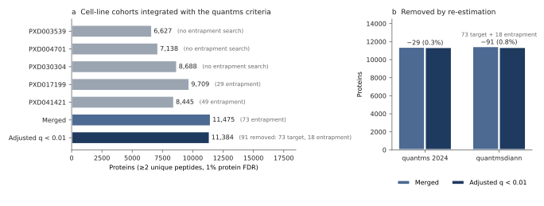

# Integrating the cell-line cohorts: protein FDR across studies (reviewer response R1.9)

Each cohort in the manuscript was analysed in its own quantmsdiann run, so no
identification is transferred between studies. Within a run, FDR is controlled over
the whole cohort: precursor and protein-group q-values are estimated once on the
cohort's empirical library (`Lib.Q.Value` and `Lib.PG.Q.Value` ≤ 0.01).

To show what happens when independent cohorts are combined, we integrated the five
cell-line cohorts with the strategy of the original quantms study (Dai et al. 2024,
*Nat Methods*):

1. 1% protein FDR per cohort (`Lib.PG.Q.Value` ≤ 0.01);
2. at least two unique peptides per protein (distinct proteotypic sequences at `Lib.Q.Value` ≤ 0.01);
3. protein q-values re-estimated on the merged list with decoys, keeping proteins at adjusted q < 0.01.

**Result.** Of 11,475 proteins in the merged list, 11,384 passed 1% adjusted FDR (91
removed, 0.8%). This is comparable to the cell-line build of the quantms study
(11,403 to 11,374). Entrapment sequences were searched for PXD017199 and PXD041421
and are not used by the decoy step, so they give an independent check: entrapment
proteins fall from 284 (2.19% of the merged list) to 73 (0.64%) with the
two-peptide rule, and to 55 after re-estimation. Lowering the cut-off until the
entrapment-estimated FDP of the merged list was ≤ 1% removed 9 more proteins,
leaving 11,375 proteins with 51 entrapment proteins (0.45% of the list; estimated FDP 0.98%, Response Table 1).

## Response Table 1

Proteins counted per accession (every member of a protein group); contaminants
removed. Entrapment FDP uses the combined estimator (Wen et al. 2025) over proteins
seen in a cohort searched with entrapment; "n/a": cohort searched without entrapment.

| Set | 1% protein FDR: proteins | entrapment | entrapment FDP | + ≥2 unique peptides: proteins | entrapment | entrapment FDP |
|---|---:|---:|---:|---:|---:|---:|
| PXD003539 (NCI-60) | 7,506 | 0 | n/a | 6,627 | 0 | n/a |
| PXD004701 (Sun 2023) | 8,224 | 0 | n/a | 7,138 | 0 | n/a |
| PXD030304 (ProCan) | 9,918 | 0 | n/a | 8,688 | 0 | n/a |
| PXD017199 | 10,608 | 125 | 2.34% | 9,709 | 29 | 0.59% |
| PXD041421 | 9,275 | 184 | 3.94% | 8,445 | 49 | 1.15% |
| Merged (union of the five lists) | 12,949 | 284 | 4.94% | 11,475 | 73 | 1.40% |
| Merged, decoy-adjusted q < 0.01 | 12,361 | 150 | 2.68% | **11,384** | 55 | 1.06% |
| Merged, decoy-adjusted q < 0.01 and entrapment FDP ≤ 1% | 11,893 | 54 | 0.99% | **11,375** | 51 | 0.98% |

The entrapment cut-off corresponds to a merged q-value of 0.00080 (1% protein FDR
rule) and 0.00269 (≥2 unique peptides rule). Proteins removed from each cohort are
listed in [`integration_removed_by_project_min2_unique_peptides.tsv`](integration_removed_by_project_min2_unique_peptides.tsv)
and [`integration_removed_by_project_1pct_protein_fdr.tsv`](integration_removed_by_project_1pct_protein_fdr.tsv).



**(a)** Proteins per cohort and after merging (≥2 unique peptides, 1% protein FDR).
**(b)** Proteins removed by re-estimating q-values on the merged list, for the
quantms 2024 cell-line build and for this study.

## Method

- **Per cohort.** Protein groups at `Lib.PG.Q.Value` ≤ 0.01 from each cohort's DIA-NN
  report, with the number of unique peptides (distinct proteotypic `Stripped.Sequence`
  at `Lib.Q.Value` ≤ 0.01). Each accession keeps its lowest q-value.
- **Decoy re-estimation (quantms).** In each cohort list, sorted by q-value, decoys
  are added so that the decoy/target ratio at every target equals its q-value. The
  lists are merged, each accession keeps its lowest q-value, and q-values are
  re-estimated as decoys / targets scoring as well or better (made monotone).
  Proteins at adjusted q < 0.01 are kept.
- **Entrapment check.** `ENTRAP_` accessions (PXD017199 and PXD041421 only) are kept
  as targets during integration and only counted afterwards. FDP = N_e (1 + 1/r) /
  (N_t + N_e), with r the ratio of entrapment to target FASTA entries.

## Reproduce

```bash
python -m scripts.review_integration_fdr      # tables in this folder
python -m scripts.review_integration_figure   # response_R1.9_integration.svg
```

Code: [`scripts/review_integration_fdr.py`](../../../../scripts/review_integration_fdr.py),
[`scripts/review_integration_figure.py`](../../../../scripts/review_integration_figure.py)
and the entrapment estimator in [`scripts/review_entrapment_fdp.py`](../../../../scripts/review_entrapment_fdp.py).

Inputs are the DIA-NN reports of each cohort on the PRIDE FTP (streamed; a local copy
in `data/<PXD>/diann_report.parquet` is used when present):

| Cohort | DIA-NN report |
|---|---|
| PXD003539 | https://ftp.pride.ebi.ac.uk/pub/databases/pride/resources/proteomes/quantmsdiann-benchmarks/cell-lines/PXD003539/v2_5_1_enterprise/quant_tables/diann_report.parquet |
| PXD004701 | https://ftp.pride.ebi.ac.uk/pub/databases/pride/resources/proteomes/quantmsdiann-benchmarks/cell-lines/PXD004701/v2_5_1/quant_tables/diann_report.parquet |
| PXD030304 | https://ftp.pride.ebi.ac.uk/pub/databases/pride/resources/proteomes/quantmsdiann-benchmarks/cell-lines/PXD030304/v2_5_1/quant_tables/diann_report.parquet |
| PXD017199 | https://ftp.pride.ebi.ac.uk/pub/databases/pride/resources/proteomes/quantms-collections/absolute-expression-2.0/cell-lines/PXD017199/quant_tables/diann_report.parquet |
| PXD041421 | https://ftp.pride.ebi.ac.uk/pub/databases/pride/resources/proteomes/quantms-collections/absolute-expression-2.0/cell-lines/PXD041421/quant_tables/diann_report.parquet |

The entrapment FASTA is
[`sdrf/fasta/Homo-sapiens-uniprot-reviewed-entrap-contaminants-202605.fasta.gz`](../../../../sdrf/fasta/Homo-sapiens-uniprot-reviewed-entrap-contaminants-202605.fasta.gz).

## Files

| File | Content |
|---|---|
| `integration_fdr.tsv` | Response Table 1, both rules |
| `integration_removed_by_project_*.tsv` | Proteins of each cohort removed by the decoy and entrapment steps |
| `response_R1.9_integration.svg` | Figure above |

This analysis is part of the response to the reviewers only; the resource does not
claim integrated protein lists across cohorts.
